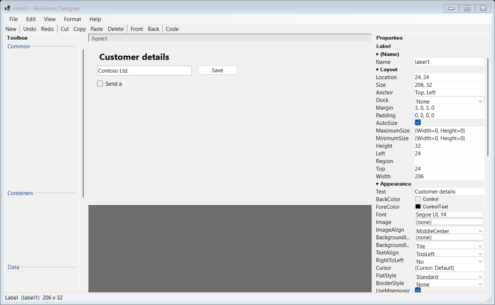

# WinForms Designer

A standalone Visual Studio style designer for Windows Forms. It runs on .NET 10 as a
self contained desktop application and needs **no Visual Studio and no design time
assemblies** — the toolbox, the property grid and the code generator are all implemented
from scratch.



## What it does

| Area | Behaviour |
| --- | --- |
| Design surface | Open an existing `.designer.cs` file, drag, move and resize controls, select them, use alignment guides and snap to grid. |
| Toolbox | Common WinForms controls grouped by category. Drag a control onto the surface or double click it. |
| Property grid | Categories, inline editors for text, numbers, colours, fonts, images, collections and component references. |
| Events | Common events of the selected control can be wired to named handler stubs. |
| Editing | Cut, copy, paste, delete, select all, align, bring to front, send to back. |
| Undo / redo | Every committed edit is a single undo step. |
| Code generation | Writes a complete, compilable WinForms project: `Form1.cs`, `Form1.designer.cs`, a `.csproj` and `Program.cs`. |

## Requirements

* Windows
* .NET 10 SDK to build (the published executable needs nothing but Windows)

## Build and run

```powershell
dotnet build WinFormsDesigner.slnx
dotnet run --project src/WinFormsDesigner.App/WinFormsDesigner.App.csproj
```

## Publish a portable executable

```powershell
dotnet publish src/WinFormsDesigner.App/WinFormsDesigner.App.csproj `
  -c Release -r win-x64 --self-contained true -p:PublishSingleFile=true `
  -p:EnableCompressionInSingleFile=true -o publish/win-x64
```

The result is a single `WinFormsDesigner.exe` (about 49 MB) that contains the whole
runtime. Copy it anywhere and run it.

## Using the designer

1. Choose **File ▸ Open…** (`Ctrl+O`) and select a WinForms `.designer.cs` file to load an existing form.
   The loader reads standard control fields, common property assignments, event handler names,
   and `Controls.Add`/`Controls.AddRange` hierarchy entries; it does not execute the source.
2. Pick a control in the toolbox and drag it onto the form, or double click it to drop it
   in the middle of the form.
3. Select a control to edit its properties on the right hand side.
4. Use **File ▸ Generate Code…** (`Ctrl+G`) to review the generated designer file and write
   the whole project to a folder. The folder contains a runnable project:

   ```
   MyApp/
     MyApp.csproj
     Program.cs
     Form1.cs
     Form1.designer.cs
   ```

   `dotnet build` in that folder produces a working application.

The generated `.designer.cs` follows the Visual Studio layout: all controls are
instantiated first, every container is suspended before it is filled and resumed in
reverse order afterwards, so the file behaves exactly like the one Visual Studio writes.

## Project layout

```
WinFormsDesigner.slnx
Directory.Build.props            Shared compiler settings
src/WinFormsDesigner.Core/       Model, reflection and code generation (no UI)
src/WinFormsDesigner.App/        The designer application
```

### Core

| File | Purpose |
| --- | --- |
| `Model/DesignDocument.cs` | The document: class name, namespace, project name, root node. |
| `Model/DesignNode.cs` | A node in the control tree: type, name, children, properties, events. |
| `Model/PropertyBag.cs` | Stores only the values that differ from the control default. |
| `Model/ColorText.cs` | Formats colours for the property grid. |
| `Reflection/ControlTypeRegistry.cs` | The toolbox catalogue and the VS style naming rules. |
| `Reflection/ControlFactory.cs` | Creates live control instances and reads default values. |
| `Reflection/PropertyCatalog.cs` | Lists the browsable properties of a control type. |
| `Reflection/PropertyMetadataTable.cs` | Categories and editor kinds of the known properties. |
| `Codegen/CSharpFormGenerator.cs` | Writes the designer file, the code behind and the project files. |
| `Codegen/CSharpValueFormatter.cs` | Formats property values as C# literals. |

### App

| File | Purpose |
| --- | --- |
| `MainForm.cs` | Menu, toolbar, status bar and the three pane layout. |
| `Designer/DesignSession.cs` | Owns the document, the live control tree, the selection and the undo history. |
| `Designer/DesignerSurface.cs` | The design surface: painting, hit testing, pointer input, dragging, resizing and guides. |
| `Designer/AdornmentLayer.cs` | Transparent overlay that draws the selection adornments. |
| `Toolbox/ToolboxPanel.cs` | The grouped toolbox list and the drag payload. |
| `Toolbox/GlyphFactory.cs` | Draws the toolbox icons at runtime. |
| `Properties/PropertyGridView.cs` | The property grid. |
| `Properties/PropertyGridEditors.cs` | The inline editors. |
| `Properties/CollectionEditorDialog.cs` | Editor for collection valued properties. |
| `GenerateCodeDialog.cs` | Preview and write the generated project. |

## How it works

**The document is the single source of truth.** The live controls on the surface are a
projection of it. Editing a property writes the value into the document and applies it to
the live control; a change made on the live control is read back into the document. Only
non default values are stored, so the generated code stays as small as the one Visual
Studio produces.

**Z order.** `Controls.Add` appends to the back, index `0` is the front most control. The
generator emits the `Controls.Add` calls in that same order, so the stacking survives the
round trip.

**Non visual components.** Timers, tool tips, notify icons and error providers have no
visual representation. They are created through the component container and are written to
the `components` field of the generated file.

**Auto scaling.** The form is generated with `AutoScaleMode = Font` and the recorded
`AutoScaleDimensions`, so the layout scales with the system font.

## Verification

Run the focused Windows smoke harness to check `.designer.cs` parsing, loading into the live
form, control movement and resizing, cursor restoration, and undo:

```powershell
dotnet run --project tests/ParserSmoke/ParserSmoke.csproj
```

The solution build command above checks compilation. The smoke harness checks that the old
control area is repainted after a move, but interactive dragging and resizing should still be
verified on Windows. The generated project's Visual Studio Designer round trip also requires
interactive verification.
